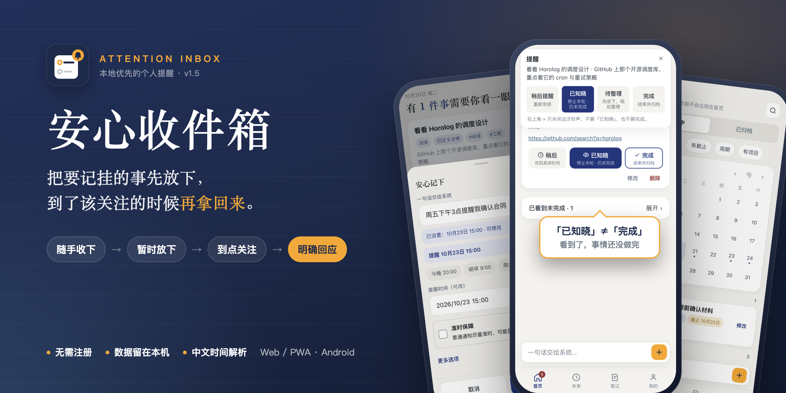
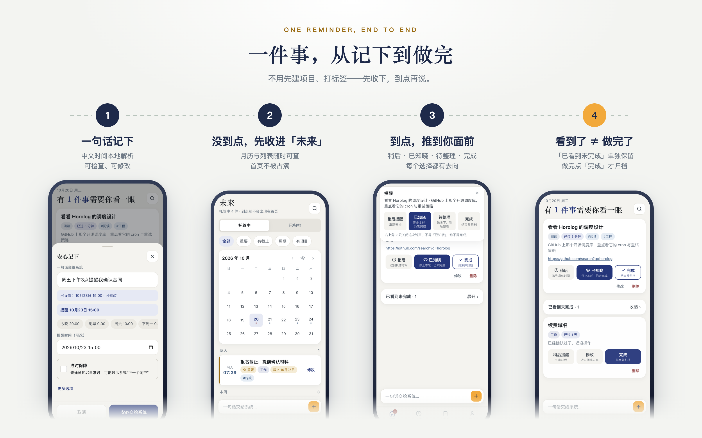

# 安心收件箱 (Attention Inbox)

<p align="center">
  
</p>

> **少记挂，不错过 —— 本地优先的注意力唤醒与未来事项托管**  
> *Remember less. Miss nothing.*

[下载 Android 1.5](https://github.com/allin2/reminder/releases/tag/v1.5) · [快速上手](#快速开始) · [English](./README_EN.md)

<p align="left">
  <a href="https://github.com/allin2/reminder/actions/workflows/test.yml"></a>
  <a href="#验证与测试"></a>
  <a href="https://github.com/allin2/reminder/releases/tag/v1.5"></a>
  <a href="#技术架构与文件地图"></a>
  <a href="#平台支持与能力边界说明"></a>
  <a href="#许可与来源说明"></a>
</p>

---

## 为什么需要「安心收件箱」？

你是否也有过这样的经历：
- 待办清单（Todoist、滴答清单）越积越长，每天打开 App 看到密密麻麻的列表，产生严重的囤积焦虑；
- 为了不错过一件事，不得不强迫自己做分类、打标签、设优先级、四象限排程——**管理工具本身反而成了沉重的注意力负担**；
- 手机弹出了提醒，你顺手划掉了通知，甚至打开看了一眼，回头却彻底遗忘；
- 或者仅仅因为手头在忙，随手点了“已完成”，导致重要事项被提前归档而彻底漏掉。

**安心收件箱不是又一个复杂的 Todo App，也不是项目协作看板。**  
它的唯一职责是：**让你把未来需要关注的事项极低成本地交出去，然后彻底放心忘记；系统会在正确的时机以足够的强度重新唤醒你，并严谨确认你是否真的看到了。**

---

## 它与待办清单、日历或系统闹钟有什么不同？

**安心收件箱只围绕一个核心问题：这件事下一次需要占用我的注意力是在什么时候？**

| 工具 / 关注点 | 核心解决的问题 | 安心收件箱的做法 |
|---|---|---|
| **待办清单 / 项目管理** | 还有哪些事要做、优先级如何、进度怎样？ | **优先决定何时重新关注。** 不需要强行建项目或打标签；未来事项未到点绝不堆在首页。 |
| **日历** | 某个时间块被什么日程占用？ | **将“提醒时机”与“截止死线”分离。** 可提前唤醒关注，拥有独立死线保护警报，也支持无时间随手记。 |
| **系统闹钟** | 能否在特定时刻发出声响？ | **严格跟进响铃之后的真实状态。** 「我知道了」「稍后 2 小时」「完成」和「仅止响」是完全独立的出口。 |
| **笔记 / 稍后读** | 灵感与资料存放在哪里？ | **给记录的事项重新浮现的机会。** 模糊或无时间琐事自动收纳到「待整理」，在定期 Review 窗口轻量提醒澄清。 |

---

## 一条事项从捕获到完成的完整闭环

<p align="center">
  
</p>

例如输入 `周五下午3点提醒我确认合同`：
1. **随手捕获（Capture）**：内置中文自然语言解析引擎秒级提取时间，输入永不阻塞；支持系统分享与桌面快捷方式。
2. **静候未来（Future）**：在提醒时刻到来前，事项静静托管在未来月历中，首页空灵无负担。
3. **到点唤醒（Now / Due）**：到期进入活跃视图，按事项重要程度发起多级唤醒（普通通知 / 阶梯重提醒 / Android 穿透锁屏全屏闹钟）。
4. **真实状态响应（Action Exits）**：

| 此时你的状态 | 点击操作 | 系统的严谨反馈 |
|---|---|---|
| **看到了，但手头在忙还没做完** | **「我知道了」(ACK)** | 停止周期性连环催促；事项安全收拢在「已看到未完成」栏中，**绝不会误当成完成**。 |
| **当前不便处理，需要稍后提醒** | **「稍后」(Snooze)** | 重新进入等待计时；应用内提供多档预设，锁屏闹钟/通知快捷键固定推迟 **2 小时**。 |
| **合同已确认，真正处理完毕** | **「完成」(Done)** | 事项进入历史归档的**唯一正常出口**；已归档事项可按日回溯或一键恢复。 |
| **正在开会，只需要闹钟立刻停响** | **「关闭 / 止响」(Mute)** | 仅停止声音与震动，不记账、不消事项、不确认 ACK，稍后仍会安全追催。 |

> [!IMPORTANT]
> **弹条发出、点开 App 或划掉通知，绝不等于「我知道了」。**  
> 包含硬截止时间的事项，即便已点击「我知道了」，在临近截止前依然受到 **24 小时 (p24)** 与 **2 小时 (p2)** 独立死线强唤醒保护。

---

## 六大核心使用逻辑

```text
┌─────────────────────────────────────────────────────────────┐
│                    Capture（极速随手记）                     │
│               一句话自然语言 · 模糊录入也绝不阻断            │
└──────────────┬──────────────────────────────┬───────────────┘
               │ (时间明确)                   │ (时间模糊)
               ▼                              ▼
┌─────────────────────────────┐┌──────────────────────────────┐
│       Future（未来）        ││     Needs Review（待整理）   │
│   托管中，默认不占用首页    ││    弱化常驻，集中窗口提醒    │
└──────────────┬──────────────┘└──────────────┬───────────────┘
               │ (到期唤醒)                   │ (整理澄清)
               ▼                              │
┌─────────────────────────────────────────────▼───────────────┐
│                 Now / Due（现在需要注意）                    │
│        普通通知  /  阶梯重提醒  /  Android 全屏锁屏闹钟      │
└──────────────┬──────────────────────────────┬───────────────┘
               │                              │
     ┌─────────┴─────────┐          ┌─────────┴─────────┐
     ▼                   ▼          ▼                   ▼
【我知道了】          【稍后 2 小时】    【关闭 / 止响】        【完成】
 (确认看到，未完成)    (重新进入等待)     (仅止响，不记账)     (唯一归档出口)
```

### 1. 极速捕获，永不失败（Capture Never Fails）
- 支持丰富的中文自然语言时间解析：“周五下班前买咖啡豆”、“每月第三个周四开例会”、“明早10点”、“本周末”。
- **录入永不阻塞**：即便输入完全没有时间信息或语法杂乱，系统也绝不弹窗报错拒绝，而是妥善存入「待整理」，绝不打断记录灵感的心流。
- **系统文本分享与快捷记录**：支持 Android 桌面长按图标快速记录，支持从第三方应用（如微信、浏览器）直接分享文本一键创建事项草稿。

### 2. 未来默认不可见（Future Hidden by Default）
- **核心原则：未到时间的事项，绝不提前消耗当前的认知带宽。**
- 首页只展示“此刻应进入注意力”的事项，不出现令人焦虑的“即将到来”长列表。
- 未来托管中的事项安静地存放在「未来」月历中，只有在你主动查看时才可见。

### 3. 「我知道了」≠「已完成」（Acknowledged ≠ Completed）
- 传统清单的最大缺陷：划掉通知或标记查看，往往等同于归档完成。
- 在安心收件箱中：
  - 点击 **「我知道了」**：向系统确认“我已经注意到这件事了”，停止连环催促，但事项依然保持活跃（收纳在弱化的「已看到未完成」栏中）；
  - 只有主动点击 **「完成」**：才是事项进入历史归档的唯一正常出口。

### 4. 真正叫得醒你的多级递进唤醒与准时保障
系统不假设“通知发出了你就一定能看到”，按事项重要程度提供多级唤醒：
- **普通事项**：常规单次通知。可按事项自选开启**「准时保障」**（借用系统高优闹钟调度通道，抵御国产 ROM 对普通通知的延迟合并与后台打压）。
- **重要事项（☆）**：首次通知 + 约每 30 分钟阶梯式重复提醒（最多 4 次），防止划掉后遗忘。
- **关键事项（🚨）**：Android **独立全屏锁屏闹钟**（`setAlarmClock` + 亮屏 + 循环响铃 + 波形震动 + 锁屏直达）。提供「我知道了 / 稍后 2 小时 / 完成 / 仅关闭止响」四个出口。

### 5. 双阶段死线独立保护（Deadline Protection）
- 即使一个事项你已经点击过「我知道了」，只要它还未最终完成，并且包含硬性截止时间（Deadline）：
- 系统会在 **截止前 24 小时（p24）** 与 **截止前 2 小时（p2）** 两个独立保护点再次拉响警报，阻止死线翻车。

### 6. 100% 本地优先与数据主权（Local-First）
- 数据完全保存在本机的 `IndexedDB` 中（自动配备 `localStorage` 镜像容灾）。
- **无需注册、无需登录、无需连接任何后端服务器**，纯离线全功能可用，隐私零泄露。

---

## 典型使用场景

| 场景 | 你的操作 | 安心收件箱的行为 |
|---|---|---|
| **走路/开会时灵光一闪** | 在底部常驻输入条直接输入 `下周二下午提醒我找老张确认合同` | 5 秒完成录入并自动解析时间，事项进入未来托管，首页保持空灵无负担。 |
| **突发琐事时间不确定** | 输入 `抽空给车做个保养` | 无法提取精确时间，自动收归「待整理」，并在下一个设定好的整理窗口（Review Window）轻量提醒你补全。 |
| **阅读文章或聊天沟通** | 选中文字点击系统分享 → 选择安心收件箱 | 自动带入待办草稿，一键保存入库，不中断当前阅读心流。 |
| **手头正在忙时闹钟响起** | 锁屏全屏闹钟响起，点击 **「稍后」** | 闹钟立刻静音，自动改期为 2 小时后重新强力唤醒你。 |
| **看到了但稍后才能做** | 弹条提醒时点击 **「我知道了」** | 停止周期性重弹，事项折叠进「已看到未完成」数字徽标中，安心忙手头的事，不用担心误当成完成。 |
| **临近关键交付前夕** | 某项目设了明天 18:00 截止，今早已点了我知道了 | 今天 18:00（倒计时 24 小时）和明天 16:00（倒计时 2 小时），系统自动发起两轮死线二次强唤醒。 |

---

## 快速开始

本项目为**零构建（Zero-Build）纯静态架构**，无需 `npm run build`，无需配置复杂的打包环境。

### 方式 A：Web / PWA 模式（跨平台开箱即用）
1. **本地静态服务运行**：
   ```bash
   # 使用 Python 启动
   python3 -m http.server 8000 --bind 127.0.0.1
   # 或使用 npx serve
   npx serve .
   ```
   在浏览器中访问 `http://127.0.0.1:8000`（手机浏览器或桌面模拟 390px 宽度体验最佳）。也可直接双击打开 `index.html` 进行基础功能预览。
2. **载入示例数据**：初次打开若列表为空，进入底部导航 **我的 → 载入示例数据**，即可秒级体验完整的状态流转。
3. **PWA 安装**：在支持的手机浏览器中点击「分享 → 添加到主屏幕」，即可享受接近原生体验的离线 Web App。

### 方式 B：Android 原生 App（享受全屏闹钟与强力唤醒）
- **正式版 APK 下载**：前往 [Release 1.5 正式版](https://github.com/allin2/reminder/releases/tag/v1.5) 下载 `attention-inbox-v1.5.apk`。
  - APK SHA-256：`59f735b998180a614e60be4fbedc5b7ff43bc6daec3d1e9f763d1ee88179439f`
  - 签名证书与 1.3 正式版完全一致，支持直接覆盖升级并保留本地数据。
- **权限支持**：完整支持 Android 12+ 精确闹钟权限与 Android 13+ 通知权限，实现锁屏全屏直接拉起、关屏响铃与开机自动恢复排程。详细发布与验证记录见 [1.5 发布记录](docs/reviews/release-v1.5-2026-10-18.md)。

---

## 平台支持与能力边界说明

| 能力维度 | Web / PWA 模式 | Android 原生 App |
|---|---|---|
| **快速捕获、中文语义解析、未来/待整理、离线笔记** | ✅ 完整支持 | ✅ 完整支持 |
| **数据本地持久化、备份与导入导出** | ✅ 完整支持 (IndexedDB) | ✅ 完整支持 (IndexedDB) |
| **应用前台/开启时到期提醒** | ✅ 完整支持 | ✅ 完整支持 |
| **锁屏全屏亮屏强唤醒、震动响铃直达** | ❌ 受浏览器沙盒限制 | ✅ 专属支持 (`setAlarmClock` + 4 出口表态) |
| **离线后台保活与准时到期送达** | ⚠️ 依赖系统向浏览器页面分发执行时间 | ⚙️ 原生调度；支持按事项开启**「准时保障」**（避免普通通知被厂商合并延迟） |

> [!NOTE]
> **国产 Android 定制 ROM 保活建议**：  
> 部分厂商系统（OPPO/vivo/小米等）后台电池优化极其激进，若应用被**系统强行停止（Force Stop）**，需重新点击图标冷启动方能恢复定时广播。为保障准时提醒与锁屏闹钟，建议在系统设置中为本应用开启：**「允许完全后台行为 / 允许自启动 / 允许锁屏显示」**。

---

## 核心交互速查表

| 操作 / 元素 | 交互与业务语义 |
|---|---|
| **快速录入 (+)** | 一句话自然语言捕获；**捕获永不失败**，解析不出的归入待整理。支持桌面快捷方式与文本分享。 |
| **现在需要注意** | 首页只呈现当前应进入注意力的事项；**不出现「即将到来」列表**。 |
| **我知道了 (ACK)** | 确认已看到，停止追问；**绝不变成完成**，保留在未完成池中。 |
| **稍后 (Snooze)** | 应用内提供 5 档预置推迟（30 分钟 / 2 小时 / 今晚 / 明早 / 本周末）+ 自定义时间；锁屏全屏闹钟与通知栏快捷动作固定推迟 **2 小时**。 |
| **完成 (Done)** | 明确点击完成，归档移出活跃空间（唯一正常归档出口）。 |
| **待整理 (Review)** | 模糊记录聚集地；平时入口弱化，到了 Review 集中窗口期显著提醒。支持多条批量处理与会话澄清。 |
| **未来 (Future)** | 托管中的所有未来事项与月历视图；默认不占首页。 |
| **已归档 (Archive)** | 按日回溯已完成历史，可一键恢复；恢复后不自动设置提醒。 |
| **全屏闹钟** | 针对重要/关键事项的首次提醒，穿透锁屏全屏亮屏弹出，4 出口明确表态。 |
| **准时保障 (可选)** | 针对普通通知易被系统休眠合并问题，可按事项勾选占用高优闹钟调度，保障准时投递。 |
| **离线笔记** | 内置轻量 Markdown 笔记，可置顶、关联项目。 |
| **AI 智能理解 (可选)** | 设置中可自备 OpenAI 兼容 Key（BYOK），失败自动平滑降级为本地纯正则解析。 |

---

## 硬核工程与可靠性保障

安心收件箱表面极其轻量简洁，底层却历经了严格的并发冲突、状态一致性与原生穿透加固：

- **D41 统一事务模型**：
  - 彻底杜绝在异步存储提交期间丢失用户点击。采用**不可见草稿隔离（Draft Isolation）**，原生锁屏动作先在独立内存草稿中变更，待 IndexedDB 提交确认后再安全发布至 UI。
  - 提交窗口期内同一事项的新命令明确拒绝并提示重试，无关事项的并发命令则通过稳定 ID 有序重放到草稿中，杜绝界面脏读与竞态覆盖。
- **权威持久化与重启一致性**：
  - 以 IndexedDB 为绝对权威后端，localStorage 为尽力同步镜像；每次提交生成深拷贝独立快照，保证断电与重载后的真实状态与视觉完全一致。
- **Android 原生强唤醒与状态对账**：
  - 采用原生 `NotificationScheduler` 与 `AlarmActivity` 实现全屏闹钟四出口表态与状态回传。
  - 排程差量对账机制：仅在提醒计划实际改变时触发系统闹钟重新注册，杜绝自激循环与幽灵闹钟。

<details>
<summary>点击展开：真机运行验证与工程测试记录</summary>

- **真机实测验证范围**：
  - OPPO PKC130 / Android 16：验证了后台横幅、息屏 AOD、停止声振以及全屏闹钟最短链路（详见 [OPPO 修复验收](docs/reviews/android-oppo-hidden-alarm-20260918.md) 与 [OPPO 真机验收](docs/reviews/health-oppo-pkc130-2026-10-16.md)）。
  - vivo V2238A / Android 16：验证了息屏闹钟与应用退出后的冷启动闹钟唤醒（详见 [vivo 验证记录](docs/reviews/android-vivo-f6c-functional-20260918.md)）。
  - 原生全屏闹钟的「关闭 / 我知道了 / 稍后 2 小时 / 完成」四个真实按钮均通过真机验证，并复核持久化结果与剩余排程。
- **厂商后台策略是可靠性前置条件**：需开启 **允许后台耗电 + 锁屏显示 + 自启动**。超长待机、系统强行停止、省电模式等复杂场景不外推为全部通过。
- 更多详尽测试报告见 [docs/reviews/](docs/reviews/) 目录。

</details>

---

## 验证与测试

项目拥有严密的自动化测试套件（覆盖自然语言解析、并发提交隔离、重启一致性、模拟断电与 Android 原生排程对账）：

```bash
npm test
```

**测试套件概览（15/15 全部通过，累计 3,460+ 项检查点全部 PASS）：**
- `test-unit.js`：中文自然语言解析、相对时间计算、周期推进（日历锚点 vs ACK 锚点）、中文数字转换
- `test-native-reminders.js`：Android 原生通知投影、全屏闹钟路由、厂商后台引导、准时保障排程与失败恢复
- `scripts/verification/p3a~p3i`：核心架构解耦验证套件（数据模型、持久化、D41 事务、事项流转、协调器、整理会话、告警策略、平台桥接与模块化闭包）
- `test-boot-combination.js`：冷启动装配矩阵、依赖缺失防护与启动失败闭环验证
- `test-smoke.js`：端到端生命周期冒烟测试（录入、展示、弹条、会话出口）
- `test-regressions.js`：736 项定向回归测试（D41 事务隔离、命令重放、模拟断电重启一致性、3 原生动作 × 6 UI 命令 36 组合矩阵）
- `scripts/verification/parse-single-source.js`：中文时间解析单一来源契约与语料闭合测试

---

## 技术架构与文件地图

```text
├── index.html                  # App 单页结构、布局与样式（零构建，开箱即用）
├── app-core.js                 # 核心协调器（状态装配、UI 挂载、FIFO 提交闸门）
├── sw.js / manifest.json       # PWA 离线 Service Worker 与清单
├── lib/                        # 高内聚解耦业务模块
│   ├── app-model.js            # 数据模型与不可变状态规范
│   ├── app-transaction.js      # D41 事务引擎与草稿隔离机制
│   ├── app-persistence.js      # 权威持久化协调器
│   ├── app-capture.js          # 表单输入会话、快捷录入与解析集成
│   ├── app-review.js           # 待整理系统、整理窗口与批量归纳
│   ├── app-alerts.js           # 告警策略、免打扰(DND)与死线保护
│   ├── app-views.js            # 视图渲染器（首页/未来/归档/详情/统计）
│   ├── parse-cn.js             # 中文自然语言时间解析引擎（独立纯函数）
│   ├── repeat.js               # 周期递推规则（日历锚点 vs ACK 锚点）
│   ├── storage.js              # IndexedDB 权威存储适配器
│   └── native-reminders.js     # Capacitor 原生通知排程与状态对账层
├── android/                    # Capacitor 6 Android 原生平台工程
│   └── app/src/main/java/space/alliswell/inbox/
│       ├── MainActivity.java           # 主界面与快捷方式接收
│       ├── AlarmActivity.java          # 锁屏全屏闹钟 Activity（4 出口表态）
│       ├── NotificationScheduler.java  # 原生通知与准时保障调度器
│       ├── CaptureIntentPlugin.java    # 系统文本分享与快捷 Intent 插件
│       ├── SystemBridgePlugin.java     # 精确闹钟与通知渠道桥接
│       └── BootRestoreReceiver.java    # 开机自愈重排广播接收器
└── scripts/verification/       # 自动化体检与专项验证套件
```

---

## Android 客户端与打包

如需自行修改原生代码或打出签名包：

```bash
npm ci
npm run sync:www      # 将 Web 静态资源同步至 www/
npm run cap:sync      # 同步至 android/ 工程
npm run cap:open      # 在 Android Studio 中打开工程进行编译构建
```

- **环境要求**：Node.js ≥ 18，JDK 17，Android Studio + Android SDK (API 34)。

---

## 许可与来源说明

本项目理念与部分能力融合自 [alliswell](https://github.com/allin2/reminder) 任务/提醒/笔记体系，并严格遵循 [Attention Inbox V0.2 业务规格基线](docs/baseline/Attention_Inbox_V0.2_产品需求与业务规格基线.md)。  
版权与许可协议以各原始代码仓库声明为准。
