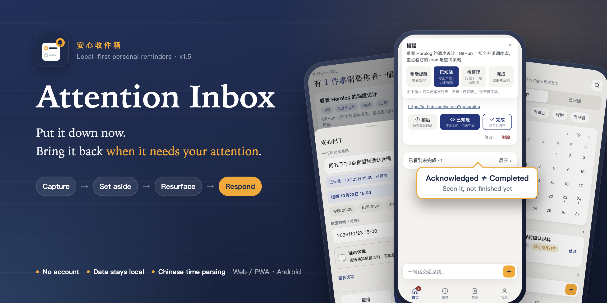
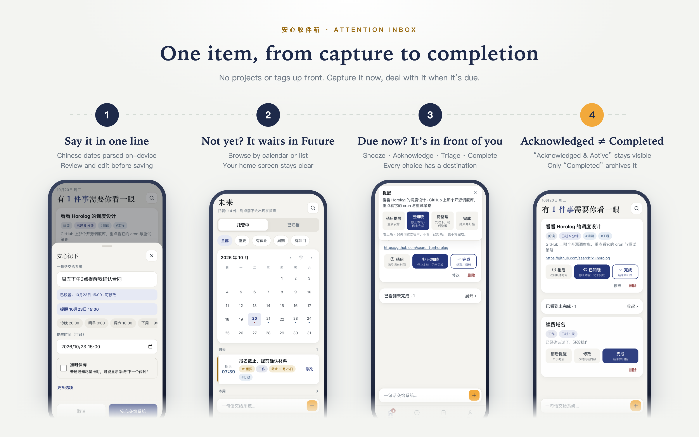

# Attention Inbox (安心收件箱)

<p align="center"></p>

> **Put it down now. Bring it back when it needs your attention.**

A local-first personal reminder app: capture something you need to revisit, keep it in **Future** until its reminder time, then bring it back to your attention. **“Acknowledged” means you saw it. “Completed” means you finished it.**

The app interface and built-in natural-language time parser are in Chinese.

[Download Android 1.5](https://github.com/allin2/reminder/releases/tag/v1.5) · [Quick start](#quick-start) · [简体中文](./README.md)

[](https://github.com/allin2/reminder/actions/workflows/test.yml)
[-1b6b4a.svg)](#verification-and-testing)
[](https://github.com/allin2/reminder/releases/tag/v1.5)


## How does it differ from a to-do list, calendar or alarm?

**Attention Inbox starts with one question: when does this need my attention again?**

| Tool / focus | Main question it addresses | Attention Inbox’s approach |
|---|---|---|
| To-do list / project manager | What needs doing, in what order, and how is it progressing? | **Decide when to revisit it first.** No project or tag required; future items stay off Home until their reminder time. |
| Calendar | What activity occupies a time slot? | **Separate the reminder from the deadline.** Revisit something early, keep deadline alerts, or capture it before choosing a time. |
| Alarm | Can you alert me at a particular time? | **Keep track of what happens after it rings.** Acknowledge, snooze, complete and mute are separate actions. |
| Notes / bookmarks | Where can I save information for later? | **Give the record a chance to resurface.** Items without a clear time go to Needs Review for a scheduled review window. |

Other tools may offer individual features too. The distinction is the default workflow: **capture → set aside → revisit when due → respond explicitly**, reducing the need to keep checking a list for things you might have missed.

## One item, from capture to completion

<p align="center"></p>

Try `周五下午3点提醒我确认合同` (“Remind me to confirm the contract on Friday at 3 pm”):

1. **Capture now:** the local Chinese parser extracts a reminder time. Check or edit it before saving; no categorization required.
2. **Before it is due:** find it in the Future list or calendar, without keeping it on Home.
3. **When it is due:** it enters Now / Due and uses the selected reminder method.
4. **Respond with your actual status:**

| Your situation | Action | Result |
|---|---|---|
| I saw it, but have not finished | **Acknowledged (我知道了)** | Stops the current round of regular follow-ups; keeps the item in Acknowledged & Active. |
| I need another reminder later | **Snooze (稍后)** | Reschedules it. Choose a time in-app; Android notification / alarm shortcuts snooze for 2 hours. |
| The contract is confirmed | **Completed (完成)** | Archives the item; it can be found and restored later. |
| I only need the ringing to stop | **Dismiss / mute (关闭 / 止响)** | Stops sound and vibration without acknowledging or completing the item. |

**Sending a notification, opening the app or muting an alarm never counts as acknowledgement.** An unfinished item with a separate deadline still retains its deadline protection alerts.

## Four designs to try

### Future items stay off Home

Home focuses on what needs attention now. Acknowledged but unfinished items can be expanded when needed; future items live in their own list and calendar. Capturing more does not mean rereading every future commitment each time you open the app.

### Capture before you know the time

Enter `抽空给车做个保养` (“Get the car serviced sometime”) and keep it in Needs Review until a review window, when you can clarify the time and content. **Failure to extract a time does not itself prevent capture.** Ambiguous input containing time clues may ask for a brief clarification; saving still depends on successful local storage.

### Match the reminder to the item, and protect deadlines separately

- **Normal items:** support notifications, or alarms according to the default delivery setting.
- **Important / critical items:** use an alarm for the first Android reminder, with limited follow-ups by priority. Acknowledgement stops the current round of regular follow-ups.
- **Items with deadlines:** have independent protection points **24 hours and 2 hours before the deadline**, keeping “seen” distinct from “finished before it is due.”
- **Android 1.5 punctual reminders (准时保障):** an opt-in setting per ordinary notification, off by default. Enabling it may occupy the system’s “next alarm” slot. Needs Review continues to use standard scheduling.

Android alarms request a full-screen view while locked / screen-off, or a system banner while another app is in the foreground. Actual presentation and timing depend on permissions, notification channels and vendor background policies. Web / PWA limits are described below.

### Use it without an account; keep core features offline

Items, notes and settings are stored locally. Capture, Chinese time parsing and review require no account or application backend. Backup export / import lets you keep your own copies. **Built-in cross-device cloud sync and team collaboration are not currently provided.**

AI understanding is optional and off by default. It requires your own OpenAI-compatible service configuration; text submitted for parsing is sent to that configured service. Failures fall back to local parsing. AI is not required to use the app.

Also included: recurring reminders, quiet hours, configurable alarm duration, lightweight Markdown notes, and search across items, tags, projects and notes.

## Who is it for?

- People with personal follow-ups, renewals, maintenance or other things that need attention later.
- People who want to capture first and clarify in batches, without organizing every item immediately.
- People who need to say “I saw it, but it is not finished,” or manage a reminder separately from a deadline.

For team assignments, project dependencies, time tracking or automatic cross-device sync, choose a collaboration / task management tool with those capabilities. Attention Inbox currently focuses on capturing, reminding and responding to personal items.

## Quick start

### Android: native notifications and alarms

1. Open [Release 1.5](https://github.com/allin2/reminder/releases/tag/v1.5) and download the signed `attention-inbox-v1.5.apk`.
2. Follow the in-app guidance for notifications, exact alarms, lock-screen display and background operation.
3. Set a short reminder and try it with the app in the background and the screen off on your own phone before using it for everyday items.

### Web / PWA: try the interaction without a build

Serve the repository root with a static server. For example, if Python 3 is installed:

```bash
python3 -m http.server 8000 --bind 127.0.0.1
```

Open the [local app](http://localhost:8000). **Mine → View demo (我的 → 查看演示)** previews examples without writing them into your data. You can also capture your own item using the bottom input bar.

Supporting browsers can install the page to the home screen. Offline caching requires a successful initial load; Service Workers require HTTPS or localhost. Opening `index.html` directly provides a preview, without full PWA capabilities.

## Platform and reminder limits

| Capability | Web / PWA | Android |
|---|---|---|
| Capture, local Chinese parsing, Future / Needs Review, notes | Supported | Supported |
| Local storage, backup export / import | Supported | Supported |
| In-app due reminders | Supported while the page gets execution time | Supported |
| Native scheduling after the page closes, lock-screen alarms | No promise of timely background reminders or lock-screen wakeup | Native implementation, subject to device settings and system policies |

Standard ordinary notifications can still be delayed on some vendor devices. After a system **force stop**, the app must be reopened to resume operation. Do not use it as the sole safeguard for critical commitments.

The [1.5 release record](docs/reviews/release-v1.5-2026-10-18.md) distinguishes source checks, build / signature checks and short-delay OPPO tests of a debug package using the same product source. **Installing the signed 1.5 APK and observing its reminders at their natural due times were not performed in that release round.** This evidence does not establish long-standby, cross-day, cold-process or wider vendor coverage.

<details>
<summary>Development, verification and project references</summary>

### Architecture

The Web app is static and requires no build; Android uses Capacitor 6. IndexedDB is the preferred store, with localStorage for mirroring and fallback. Local persistence is not a substitute for an independent backup.

| Path | Responsibility |
|---|---|
| `index.html` / `app-core.js` | App interface and core orchestration |
| `lib/app-*.js` | Capture, items, review, views, transactions, persistence and related modules |
| `lib/parse-cn.js` / `lib/repeat.js` / `lib/reminder.js` | Chinese time parsing, recurrence, quiet hours, follow-ups and deadline protection |
| `lib/storage.js` / `lib/native-reminders.js` | Local storage and Android reminder projection / reconciliation |
| `sw.js` / `manifest.json` | PWA caching and install manifest |
| `android/` | Native notifications, alarms, system permissions and schedule recovery |

### Verification and testing

```bash
npm test
```

The current entry point runs 15 suites covering parsing, state transitions, persistence, concurrent transactions, native reminder mapping and module combinations. **Passing automated checks does not establish reminder visibility or timing on a target phone.** See the [1.5 release record](docs/reviews/release-v1.5-2026-10-18.md) for checks performed at publication.

### Android development

Requires Node.js ≥ 18, JDK 17 and Android SDK (API 34). Android Studio can be used:

```bash
npm ci
npm run cap:sync      # Sync Web assets and the Android project
npm run cap:open      # Open the project in Android Studio
```

### Product references and license

- [V0.2 product baseline](docs/baseline/Attention_Inbox_V0.2_产品需求与业务规格基线.md) and [approved amendments](docs/baseline/V0.2-amendments.md).
- [Interaction decisions](docs/decisions/interaction-logic-2026-09-16.md) and [Android native reminder contract](docs/compose/spec/android-native-reminders.md).
- This project incorporates ideas and capabilities from the [alliswell](https://github.com/allin2/alliswell) task / reminder / notes ecosystem. Copyright and licensing remain subject to the respective upstream declarations.

</details>
