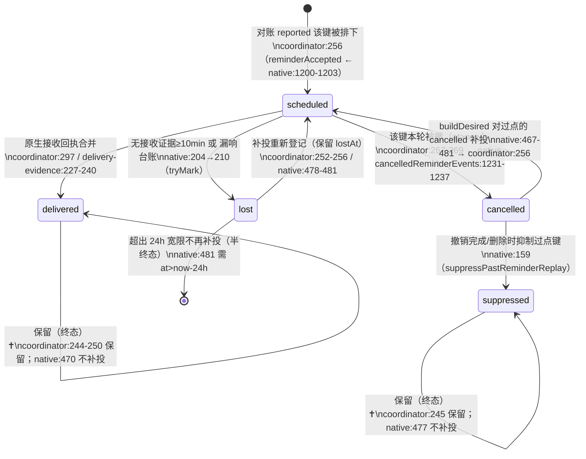

# 体检报告 · T4 提醒链路代码审计

- **执行人**: Agent（T4 检查线，单 Agent 深度代码审计）
- **日期**: 2026-10-15
- **代码版本**: `git HEAD f79b1a7396c6f5493e43a27ec88e960f8b620ac3`，未提交 40 个文件；Node v22.23.1
- **设备**: 不涉及（本线**不做真机操作**）
- **覆盖率**: 计划 9 项（HC-T4-1..9），执行 9 项，跳过 0 项。真机部分（渠道实测、Doze 实测）按要求留给 T5，本线只做代码层结论。
- **判定依据**: `docs/handoff/2026-10-15-full-health-check-plan.md` §0/§1/§3(T4)/§4/§5；V0.2 基线 + amendments；decisions；acceptance-cases.md

---

## 结论（3 句以内）

该响的都排上了、不该响的都会撤销：五态台账**无「进得去出不来」的死状态**，`buildDesired` 的补投语义与注释逐条一致。唯一 P0 级风险是**第二轮已标的 B-2 仍存在**：`markLostReminders` 的「无接收证据 ≥10 分钟」是**单一阈值**，未按精确闹钟权限分流，非精确闹钟在 Doze 下延迟超 10 分钟时会误判 `lost` → 补投 → 与原闹钟重复响。已知问题 P0-①（渠道）、P0-②（卡死）在代码层确认已修复；A-8（删除不止响）、B-3（通知载体无证据）仍为遗留（A-8 有产品内兜底）。

## 用例结果

| ID | 结果 | 证据 | 备注 |
|---|---|---|---|
| HC-T4-1 台账状态机 | ✅ | `lib/app-native-coordinator.js:252-269,297`；`lib/native-reminders.js:147,159,181,210,458-481`；`lib/delivery-evidence.js:227-240` | 五态齐全，无死状态；转移图见下 |
| HC-T4-2 补投语义 | ✅ | `lib/native-reminders.js:458-482`（分流）、`:501-518`（只补一条）、`:204`/`:231`（lost 只判一次） | 与 `buildDesired` 注释逐条一致 |
| HC-T4-3 丢失判定误报面 | ⚠️（P0 边界） | `lib/native-reminders.js:183,221,229,231`；`AlarmScheduler.java:112-115,149-157,229-233` | B-2 仍存在；场景+概率见「发现的问题」 |
| HC-T4-4 撤销完整性 | ⚠️（A-8 遗留） | `AlarmScheduler.java:248-269`；`SystemBridgePlugin.java:1289-1304`；`lib/native-reminders.js:763-778` | 未来排程全撤；**正在响铃的那一次不撤**（A-8） |
| HC-T4-5 截止保护 p24/p2 | ✅ | `lib/app-items.js:168-171,448,463-466`；`lib/native-reminders.js:529-567`；`lib/app-model.js:72` | ACK/稍后/待整理后仍生效；归档恢复暂停；N-08 只补一条 |
| HC-T4-6 勿扰时段 | ✅ | `lib/reminder.js`（`effectiveTriggerAt`，仅 normal 顺延）；`lib/native-reminders.js:627-634`（Review shift）；`lib/app-items.js:154` | 普通延后；重要/关键穿透；Review 服从勿扰 |
| HC-T4-7 并发与重入 | ✅ | `lib/app-native-coordinator.js:306-311,313-349`；`lib/app-transaction.js:26,273-281,305-311`；`test-regressions.js:2212-2222` | 有防重入；36 矩阵未含新增台账态（见 P2） |
| HC-T4-8 单一来源 | ✅ | `lib/reminder.js` REALERT / DEADLINE_GRACE_MS；`lib/native-reminders.js:79,86`；`AlarmTestReceiver.java:40`；`SystemBridgePlugin.java:64`；`test-native-reminders.js:2396-2398` | 次数/间隔/宽限期/渠道 id 均单点；另一处见 P2 |
| HC-T4-9 排程上限 | ✅ | `lib/native-reminders.js:1125-1130,1148-1155` | 无永久饥饿；边界见 P2 |

---

## HC-T4-1 台账状态机转移图（`reminderEvents`）

图例：实线=常规转移；`✝`=终态。括号内为触发点代码位置。



ASCII 版（同上，便于逐行核对）：

```
                        ┌───────────────(撤销完成/删除: native:159)──────────────┐
                        │                                                        ▼
 [无记录] ──排下──▶ scheduled ──回执──▶ delivered ✝        cancelled ──补投──▶ scheduled
      ▲                 │  │                                    ▲                │
      │                 │  └──本轮被撤(at>now, coord:267)──▶ cancelled             │
      │                 │                                       │                │
      └──补投登记──────  └──无证据≥10min/漏响台账(native:210)──▶ lost ──补投──▶ scheduled
                                                                        (lostAt保留, 只判一次)
   终态：delivered ✝ / suppressed ✝ ；跨越 24h 宽限的 cancelled、lost 不再补投（半终态）
```

**「每条转移由哪行触发」明细**：

| 转移 | 触发代码 | 说明 |
|---|---|---|
| — → `scheduled` | `app-native-coordinator.js:256` | 原生 reported（`reminderAccepted`，`native-reminders.js:1200-1203`）里出现的键 |
| `scheduled` → `delivered` | `delivery-evidence.js:227-240`（由 coordinator `:297` 落账） | 有本轮的接收回执（carrier/roundBase 匹配） |
| `scheduled` → `cancelled` | `app-native-coordinator.js:267-269` | 键不在本轮 planned、且 `at>now`、且在 `cancelledReminderEvents` 中（`native-reminders.js:1231-1237`） |
| `scheduled` → `lost` | `native-reminders.js:210`（`tryMark`，前置 `:204`） | ①漏响台账 `:214-219`；②`evidenceReadable` + `at ≤ now-10min` + 在证据保留期内 `:221-235` |
| `cancelled` → `scheduled` | `native-reminders.js:467-482` → `coordinator:256` | 过点的 cancelled 不在 skip 列表（skip 仅 delivered/scheduled/suppressed，`:470-477`）→ 进 `missed` → 补投 |
| `lost` → `scheduled` | `coordinator:252-256`（`lostMark` 保留 `lostAt`） | 补投后重新登记；`lostAt` 在册即不再判丢失 |
| `cancelled` → `suppressed` | `native-reminders.js:159` | `suppressPastReminderReplay` 只把 `at ≤ now` 的 `cancelled` 键转 `suppressed`；调用点 `app-items.js:357`（删除撤销）、`:549-550`（完成撤销） |
| 终态 `delivered` | `coordinator:244-250` 保留 + `native:470` 跳过 | 理由：已确认送达，不再打扰 |
| 终态 `suppressed` | `coordinator:245` 保留 + `native:477` 跳过 | 理由：用户按「完成/删除」主动撤销过，禁止重放（R5） |
| 半终态 `cancelled`/`lost`（>24h） | `native:481`（`at > now - DEADLINE_GRACE_MS`） | 理由：超宽限期不再补，避免半夜打扰（1.3 取舍） |

**判定**：不存在「进得去出不来」的状态——`lost`/`cancelled` 都有出边（补投回 `scheduled`），`delivered`/`suppressed` 作为终态各有明确理由（已送达 / 用户显式撤销）。`suppressed` 只能由 `cancelled` 进入，无法反向，属刻意（R5）。✅

---

## 发现的问题（按严重度排序）

### P0-① B-2 仍存在：非精确闹钟下「无证据判丢失」误报 → 重复提醒
- **违反条款**：INV-10（宁可多提醒，不得漏）与「降低打扰」的张力；第二轮 B-2（§4 未修）
- **场景（可复现）**：
  1. 建一条**关键/重要**档事项，系统**未授予精确闹钟权限**（Android 14+ 新装默认拒绝）。首次提醒走闹钟载体（`shouldFirstAlarm`）。
  2. 排程时 `AlarmScheduler.schedule` 因 `canScheduleExactAlarms()=false` 降级为 `am.set(RTC_WAKEUP, triggerAt)`，mode=`inexactNoPermission`（`AlarmScheduler.java:98,112-115,149-157`）。
  3. 设备进入 Doze 深睡：`am.set()` 被推迟到维护窗口，**延迟可远超 10 分钟**（`AlarmScheduler.java:229-233` 注释明说无权限时解冻器「在冻结态会被挂起」）。
  4. 到点后 ≥10 分钟闹钟仍未响 → `DeliveryEvidenceStore` 尚无记录。此时用户打开 App（`onResume`/`init`）触发 `reconcileLostReminders`（`app-native-coordinator.js:611,624`）。
  5. `markLostReminders` 判 `lost`（`native-reminders.js:231` 判据 `at ≤ now - LOST_NO_EVIDENCE_AFTER_MS`，`LOST_NO_EVIDENCE_AFTER_MS = 10*60*1000` 于 `:183`）→ `buildDesired` 补投一条普通通知（`now+2000`，`:478-481,501-518`）。
  6. 随后原 `am.set` 闹钟在维护窗口触发 → **同一触发点响两次**（补投通知 + 原全屏闹钟）。
- **期望 vs 实际**：期望 10 分钟阈值只在精确闹钟（`setAlarmClock`）下成立；实际阈值**不区分排程模式**（`native-reminders.js:183` 单一常量；`:221` 仅以 `evidenceReadable` 把关，无 exact 能力信号）。
- **概率评估**：需三条件同时成立——(a) 无精确权限、(b) Doze 深睡使延迟 >10min、(c) 用户在延迟窗口内打开 App 触发对账。对关键档用户为**低频但非零**（真机 Doze 延迟已在第二轮观测到；本线无真机，具体时长按「推测」）。普通档不走证据判据（`:224` `shouldFirstAlarm` 把关），不受影响。
- **影响面**：无精确闹钟权限 + 关键/重要档用户；表现为「一次提醒迟到又被补一条」。
- **建议修复**：把 `LOST_NO_EVIDENCE_AFTER_MS` 按 `canScheduleExactAlarms` 分流（精确=10min，非精确=数小时/或禁用该判据，仅保留「漏响台账」这条确定性信号）。验证：`test-native-reminders.js:2401-2460` 增加「inexact 模式不凭无证据判丢失」断言。

### P1-① A-8 仍存在：删除/编辑/ACK 不撤「正在响铃的那一次」
- **违反条款**：AC-11「删除 → 所有未来调度撤销，不得幽灵提醒」的字面覆盖下，**正在投递**的那一次不在撤销范围
- **证据**：`AlarmScheduler.cancel`（`AlarmScheduler.java:248-269`）只撤 3 类 PendingIntent，不触碰 `AlarmRingService`/`ActiveAlarmStore`；`SystemBridgePlugin.cancelAlarm:1289-1304` 调 `AlarmScheduler.cancel` + `forgetAlarm`，同样不止响；对账里 `cancelNotification({preserveActive:true})`（`native-reminders.js:776`；`SystemBridgePlugin.java:1125-1126`）**刻意保留**正在响的投递。
- **期望 vs 实际**：期望删除即止响；实际响铃继续，直到用户按产品内「停止声振」或 `AUTO_SILENCE_MS` 自动静音到点。
- **影响面**：删除/修改正在响的事项时。**有兜底**：活动闹钟面板「停止声振」、完成按钮、自动静音；故非「幽灵闹钟」而是体验瑕疵。
- **建议修复**：删除/编辑正在响的 id 时额外调一次「停止投递」（可复用面板停止路径）；验证：`HC-T5-8` 真机。

### P2-① 36 组合矩阵未覆盖新增台账态
- **证据**：`test-regressions.js:2212-2222` 矩阵维度为「原生动作 {ack,snooze,done} × UI 命令 {ack,complete,snooze,edit,delete,stopRepeat} × 成败」，不含 `lost`/`suppressed`。新增态另有独立用例（`test-regressions.js` R5 段、`test-native-reminders.js:2401-2460`）。
- **影响**：并发矩阵本身完备（有 `nativeSyncInFlight`/`nativeSyncPending` 防重入，`app-native-coordinator.js:306-311,345-347`；原生动作去重 5s，`app-transaction.js:26,305-311`），但**不与新增提醒态联合验证**。

### P2-② 存在第二处闹钟排程实现，且未先查精确权限
- **证据**：`SystemBridgePlugin.scheduleAlarmInternal`（`:1198-1211`）直接 `try { am.setAlarmClock(...) } catch (Exception ignored) {}`，**未预检** `canScheduleExactAlarms`（对比 `AlarmScheduler.java:98` 先查再排并在 `:113` 记 `exactAlarmPermissionMissing`）；失败后 `:1213-1220` 才 `exact = canExactAlarm()`。
- **影响**：功能结果等价（异常被吞后走非精确分支），但**轨迹台账少一条**、两处实现重复维护，属可维护性风险。

### P2-③ 400 上限无永久饥饿，但存在「过点仍在册被裁掉」的边界
- **证据**：`allDesired` 按时间升序、裁到最近 400（`native-reminders.js:1127-1130`，排序 `:572`）。被裁项的旧闹钟在下轮成为 stale 被撤（`:748,763-778`）。
- **判定**：无「永远排不上」——下轮对账重算即会补上；仅在「被裁项在重进 top-400 时其触发点已过、且台账状态仍为 `scheduled`」时按补投规则**不补投**（与 B-3 同源，属设计取舍）。需要同时存在 >400 条临近提醒才触发。

---

## 已知问题复核（§4 逐条）

| 编号 | 复核结论 | 证据 |
|---|---|---|
| P0-① 渠道被带声模板抢先创建 | **代码已修复**（真机未验证，属 T5） | 通用模板只建 `attention-bridge-v2`（`SystemBridgePlugin.java:64,698-705`，`:702` 注释明确）；闹钟渠道只由 `AlarmTestReceiver.ensureAlarmChannel` 按 D59 建（`AlarmTestReceiver.java:40,572-589`），并显式删除 v3/v4（`:58,580`） |
| P0-② `scheduled`+已过点永久卡死 | **已修复（代码层）** | `lost` 态 + 补投（`native-reminders.js:181-183,193-235,478-481`）；`lostAt` 保留保证只判一次（`coordinator:252-256`） |
| B-2 非精确闹钟误判丢失 | **仍存在** | 见上「P0-①」；`native-reminders.js:183,221,229,231`；`AlarmScheduler.java:112-115,149-157` |
| B-3 普通通知载体无接收证据 | **遗留（未见修复）** | `markLostReminders` 只认 attempt 0 闹钟载体（`native-reminders.js:229`）；普通通知无原生证据 → `scheduled` 过点按规则不补投（`:471`）→ 强停后仍可能静默丢失 |
| A-8 删除不止响 | **仍存在**（有兜底） | 见上「P1-①」 |
| A-1/A-2/A-3..A-6、A-7 内部术语等 | 属 T3/T8 范围，本线不重复 | — |
| P1-⑦ 深色模式、P2-⑩..⑰ | 未修（不在本线范围） | — |

---

## 附：本线观察（非业务缺陷）

- 首轮并行执行 `test-native-reminders.js` 与 `test-regressions.js` 时，`test-native-reminders.js` 报 356/3 失败（D43-b、D43-l、P0-2 基线）；随后 **8 次串行/并行复跑均为 359/0**（`test-regressions.js` 730/0）。**无法复现**，疑为并行资源竞争或共享状态所致，**不作缺陷上报**，建议 T1 关注是否有可复现的时序依赖。
- `npm test` 编排为逐套件串行（`scripts/run-tests.js:36-42`），故上述并行场景不发生在门禁里。
- 本线结论均为**代码层**；B-2/A-8/渠道实测的**真机确认**归 T5。
